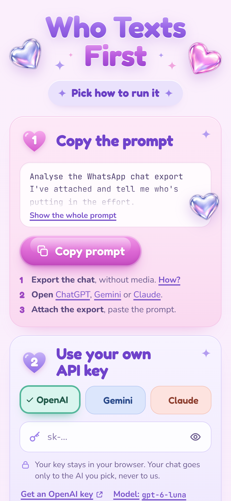
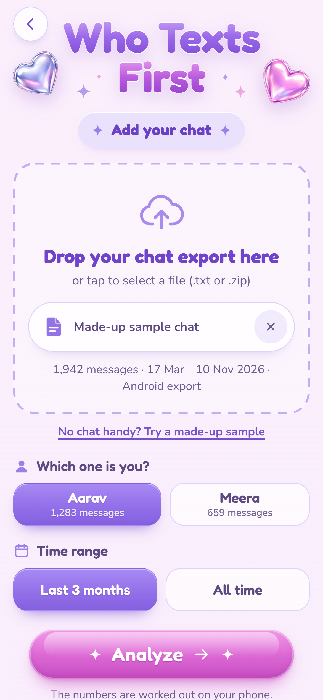
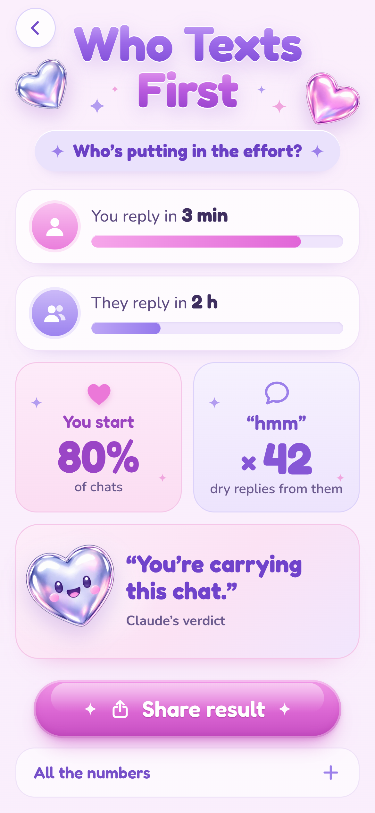

# Who Texts First

**Who's putting in the effort in your WhatsApp chat? Ask an AI.**

Live: **https://souradip121.github.io/who-texts-first/**

<p align="center">
  
  
  
</p>

<sub>Screenshots use a made-up sample chat. The verdict in them is a placeholder, not a real model answer.</sub>

A small site with no backend. It reads a WhatsApp chat export and tells you:

- each person's **median reply time** (gaps over 12 hours don't count as replies)
- who **starts the chats**: the first message after 6+ hours of silence
- **double texts**: your own follow-up 20+ minutes later, with no reply in between
- **dry replies**: "hmm", "ok", "k", "okk", "achha", "oh" and their stretched spellings
- **messages after midnight** (12 am to 4:59 am)
- and a one-line, playful **AI verdict** on who's carrying the chat.

Made by [@souradip.sh](https://www.instagram.com/souradip.sh/).

## Two ways to use it

### 1. Copy the prompt (free, no key)

1. **Export the chat** from WhatsApp, without media.
   - Android: open the chat, tap the three dots, then More, Export chat, Without media.
   - iPhone: open the chat, tap their name, then Export Chat, Without Media. (iPhone makes a `.zip`; ChatGPT can read it as it is. For Gemini or Claude, unzip it and attach `_chat.txt`.)
2. **Open** ChatGPT, Gemini or Claude.
3. **Attach the export** and paste the prompt below.

The prompt tells the AI to parse the whole file with code (so long chats aren't skimmed), handles both Android and iPhone formats, and answers with a short table plus the verdict.

<details>
<summary>The prompt</summary>

```text
Analyse the WhatsApp chat export I've attached and tell me who's putting in the effort.

READ THE WHOLE FILE
- It's a WhatsApp "Export chat" file: a .txt, or a .zip with _chat.txt inside.
- Use code (Python, code execution or the analysis tool) to parse every line. Don't estimate from a skim, and don't stop early on a long file. If you can't run code, say so, analyse the most recent 2,000 messages, and tell me that's what you did.
- Message lines start with a date and time, in one of these shapes:
  Android: 11/10/26, 9:41 pm - Name: message
  iPhone:  [11/10/26, 9:41:02 PM] Name: message
- The date can be day/month or month/day. Work it out from the data (a first number above 12 means day/month) and check the timestamps run forwards.
- Times can be 12-hour (am/pm, sometimes with a narrow space before it) or 24-hour. Ignore invisible characters like U+200E.
- A line that doesn't start with a date belongs to the message above it.
- Skip lines WhatsApp writes itself: the encryption notice, "joined", "added", "changed the subject", security codes, missed or voice calls, disappearing-message notices.
- "<Media omitted>", "image omitted" and "This message was deleted" count as messages for timing, but not as text.
- If there are more than two people, use the two who sent the most messages.

WORK OUT, FOR EACH PERSON
1. Median reply time: each time the sender changes, the gap between the other person's last message and this person's first message. Ignore gaps over 12 hours.
2. Chats started: a chat starts with the very first message and with any message after 6+ hours of silence. Give each person's share as a %.
3. Double texts: a message sent 20+ minutes after your own previous message, with no reply in between.
4. Dry replies: messages that are only "hmm", "hm", "ok", "okay", "k", "kk", "achha" or "oh", in any spelling with stretched letters, ignoring punctuation and emoji.
5. Messages after midnight: sent between 12:00 am and 4:59 am.
6. Total messages.

REPLY IN EXACTLY THIS FORMAT
A table with one row per metric and one column per person, using their names from the chat:

| | <name 1> | <name 2> |
|---|---|---|
| Median reply time | | |
| Starts chats | % | % |
| Double texts | | |
| Dry replies | | |
| After midnight | | |
| Messages | | |

Then one line: Verdict: a playful one-line verdict on who's putting in the effort, under 12 words, kind and funny, never mean.
Then one line with the date range you analysed.

Don't quote any messages and don't add anything else.
```

</details>

### 2. Use your own API key

1. Pick **OpenAI**, **Gemini** or **Claude** and paste your API key.
2. Add the chat export (`.txt`, or the iPhone `.zip` as it is).
3. Say which name is you, pick **Last 3 months** or **All time**, and tap **Analyze**.

The site works out every number on your phone. It then sends the chosen AI only those numbers plus the **last 300 messages** of the range, with the names swapped for "You" and "Them", and asks for a one-line verdict. That's a few thousand tokens per run: well under a rupee on the default models (check your provider's current prices).

**Share result** draws a 1080 × 1920 card on your phone. You can download it or send it to the share sheet; it's never uploaded.

| Provider | Default model | Get a key |
|---|---|---|
| OpenAI | `gpt-6-luna` | https://platform.openai.com/api-keys |
| Gemini | `gemini-3.5-flash-lite` | https://aistudio.google.com/apikey |
| Claude | `claude-haiku-5-5` | https://platform.claude.com/settings/keys |

If a provider retires a model, change it under **Model** on the key card, or edit `PROVIDERS` in [`js/ai.js`](js/ai.js).

## Privacy

> Your key stays in your browser. Your chat goes only to the AI you pick, never to us.

- There is no server. This is static HTML, CSS and JavaScript on GitHub Pages.
- Your chat file is read in the browser and never uploaded anywhere by this site.
- With the copy-the-prompt route, nothing leaves your phone except what you paste into the AI yourself.
- With the API-key route, one request goes straight from your browser to the provider you picked (`api.openai.com`, `generativelanguage.googleapis.com` or `api.anthropic.com`). The page's Content Security Policy blocks every other destination.
- Your key is kept in memory and in `sessionStorage`, which the browser clears when you close the tab. "Forget key" clears it at once.
- No analytics, no cookies, no trackers, no fonts or scripts from other sites.

Calling an AI API from a browser means your key is visible to that browser tab. That's fine for your own key on your own phone. Don't paste a key that belongs to someone else, and don't use an organisation key with a big spending limit.

## Run your own copy

It's plain files with no build step.

1. **Fork** this repo.
2. In your fork, open **Settings → Pages**, set **Source** to *Deploy from a branch*, pick the `gh-pages` branch (or whichever branch you use) and `/ (root)`, and save.
3. Your copy is live at `https://<your-username>.github.io/who-texts-first/` a minute later.

To run it on your computer:

```bash
python -m http.server 8000
```

Then open http://localhost:8000. (Opening `index.html` straight from disk won't work, because browsers block ES modules on `file://`.)

## Development

```bash
npm test
```

```bash
npm run sample
```

- `npm test` runs the parser and stats tests (Node 22+, no dependencies). They cover Android and iPhone exports, day/month and month/day dates, 12- and 24-hour clocks, multi-line messages, media, deleted and system lines, `.zip` exports, the request sent to each provider, and how provider errors turn into friendly messages.
- `npm run sample` regenerates the made-up sample chat in `samples/` (about 2,000 messages between two invented people). It is synthetic: no real chat is used anywhere in this project.
- `node tools/shoot.mjs` retakes the screenshots with headless Chrome, using the sample chat and a stubbed verdict.

Files:

| File | What it does |
|---|---|
| `index.html`, `styles.css` | The three screens |
| `js/parse.js` | Reads Android and iPhone exports in any date order |
| `js/zip.js` | Pulls `_chat.txt` out of an iPhone `.zip` with the browser's own `DecompressionStream` |
| `js/stats.js` | Reply times, starts, double texts, dry replies, late-night messages |
| `js/ai.js` | The verdict request for each provider, and friendly error messages |
| `js/prompt.js` | The copy-the-prompt text |
| `js/card.js` | Draws the share card on a canvas |

### Notes for contributors

- OpenAI returns its "wrong key" error without CORS headers, so a browser can't read it. The site therefore can't tell a bad OpenAI key from a network failure, and says "OpenAI turned the request down… usually the key is wrong or the account has no credit." Gemini and Claude errors come through normally.
- Claude needs the `anthropic-dangerous-direct-browser-access: true` header for browser calls; it's set in `js/ai.js`.

## Licence

[MIT](LICENSE). The chrome heart stickers in `assets/hearts/` were generated for this project; the fonts (Fredoka, Nunito, JetBrains Mono) are under the SIL Open Font License.
